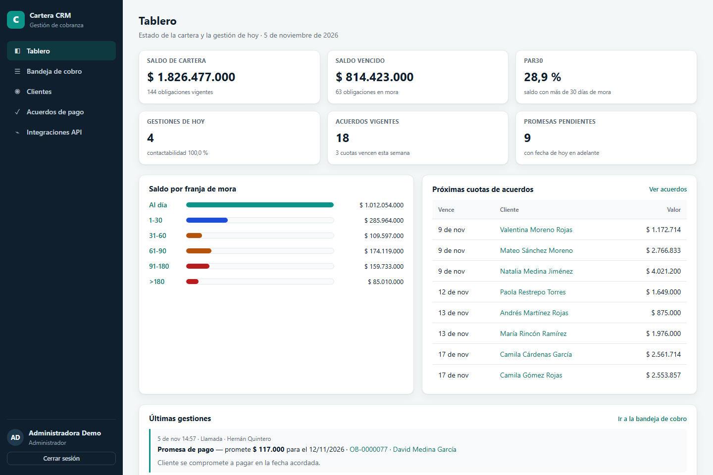
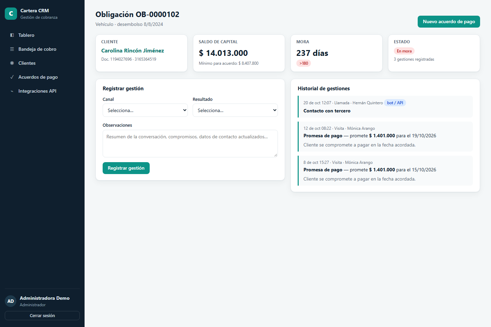
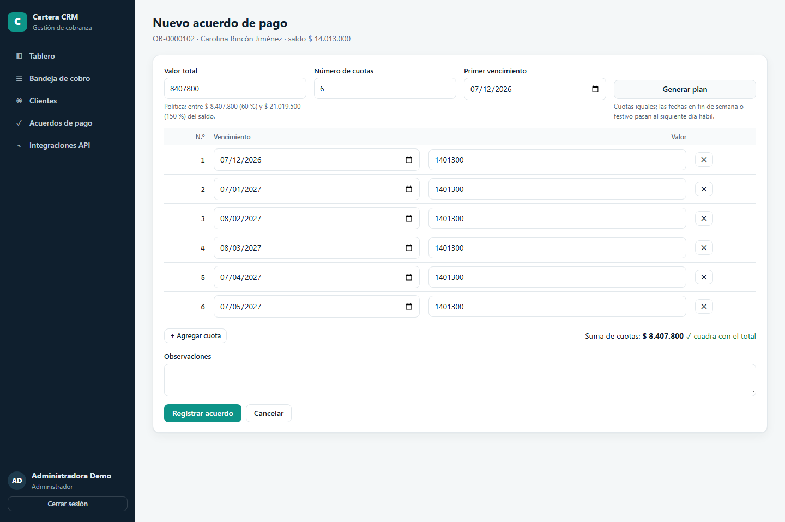
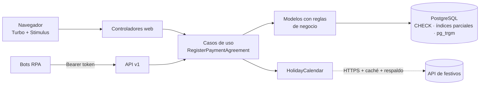

<div align="center">

# Cartera CRM

**Aplicación web de gestión de cobranza en Ruby on Rails 8 + Hotwire: bandeja de cobro,
gestiones con promesas de pago, acuerdos con plan de cuotas en días hábiles y API REST para bots.**

[](https://github.com/DarwinMontiel/cartera-crm/actions/workflows/ci.yml)


[](LICENSE)

[Arquitectura](docs/architecture.md) · [API](docs/api.md) · [OpenAPI](docs/openapi.yaml) ·
[Despliegue](docs/deployment.md) · [Decisiones (ADR)](docs/adr/)



</div>

> **English summary** — Rails 8.1 collections CRM built the Rails way: server-rendered HTML with
> Hotwire (Turbo Drive/Frames/Streams + 6 Stimulus controllers), PostgreSQL with business rules
> enforced both in models and in the database (check constraints, partial unique indexes,
> trigram search), a token-authenticated JSON API with idempotent writes for RPA bots, an external
> holiday API integration with timeouts, caching and fallback, Rails 8 authentication, Spanish
> i18n, and a CI pipeline with Brakeman, bundler-audit, RuboCop, 76 unit/integration tests and
> real-browser system tests. Deployable with Kamal 2.

---

## Qué resuelve

Un equipo de cobranza necesita, en una sola herramienta:

- **Priorizar**: ver las obligaciones vencidas ordenadas por mora y filtrar por franja.
- **Registrar cada gestión** (llamada, WhatsApp, visita…) con su resultado y, si hay promesa de
  pago, la fecha y el valor.
- **Negociar acuerdos de pago** que cumplan la política (entre 60 % y 150 % del saldo) con cuotas
  que nunca venzan un domingo o un festivo.
- **Integrarse con bots RPA** que registran gestiones y acuerdos de forma automática y segura.

## Funcionalidades

| | |
|---|---|
| **Tablero** | Saldo de cartera, saldo vencido, PAR30, gestiones y contactabilidad del día, acuerdos vigentes, promesas pendientes, saldo por franja y próximas cuotas (una consulta SQL agregada). |
| **Bandeja de cobro** | Obligaciones vencidas por días de mora con filtro por franja (`1-30` … `>180`) y paginación. |
| **Clientes** | Búsqueda en vivo por nombre o documento (Turbo Frame + *debounce*, índice de trigramas), alta y edición con normalización de documento, nombre y teléfono. |
| **Gestiones** | Formulario con campos de promesa condicionales; se agrega al historial sin recargar (Turbo Streams). Distingue gestiones hechas por personas y por bots. |
| **Acuerdos de pago** | Plan de cuotas generado en el servidor con calendario de festivos de Colombia (API pública + respaldo), filas dinámicas, suma en vivo y validación de política. |
| **API REST v1** | Token Bearer (guardado como SHA-256), errores uniformes, paginación, límite de solicitudes y registro **idempotente** de acuerdos. [Documentación](docs/api.md). |
| **Seguridad** | Autenticación nativa de Rails 8, límite de intentos de login, CSRF, SSL forzado, Brakeman y auditoría de dependencias en CI. |

<table>
  <tr>
    <td></td>
    <td></td>
  </tr>
  <tr>
    <td align="center"><sub>Obligación: registro de gestión e historial</sub></td>
    <td align="center"><sub>Acuerdo: plan en días hábiles y suma en vivo</sub></td>
  </tr>
</table>

## Arquitectura



Detalle de capas, uso de Hotwire e integridad de datos en [docs/architecture.md](docs/architecture.md).

**Integridad en dos niveles.** Cada regla crítica vive en el modelo (mensaje claro) y en la base
(garantía): por ejemplo, "un solo acuerdo vigente por obligación" es una validación **y** un
índice único parcial `WHERE status = 'active'`, que resuelve incluso solicitudes simultáneas.

## Inicio rápido

Requisitos: Ruby 3.4, PostgreSQL 14+ y Chrome (solo para pruebas de sistema).

```bash
git clone https://github.com/DarwinMontiel/cartera-crm.git
cd cartera-crm
bin/setup                 # gemas, base de datos y servidor
bin/rails db:seed         # 120 clientes, 144 obligaciones, gestiones y acuerdos de demostración
bin/dev                   # http://localhost:3000
```

Usuario demo: `admin@cartera.test` · contraseña `Cartera-Demo-2026` (solo datos de
demostración; el seed imprime además un token de API para probar la integración).

Si tu PostgreSQL no usa el usuario/puerto por defecto, exporta las variables estándar de libpq
(`PGHOST`, `PGPORT`, `PGUSER`, `PGPASSWORD`) o `DATABASE_URL`.

## Pruebas y calidad

```bash
bin/rails test            # 76 pruebas: modelos, servicios, consultas, controladores y API
bin/rails test:system     # navegador real (Chrome headless): Turbo Streams y Stimulus
bin/rubocop               # estilo (rubocop-rails-omakase)
bin/brakeman              # análisis estático de seguridad
bin/bundler-audit         # gemas con vulnerabilidades conocidas
```

Destacados de la suite:

- **Reglas de negocio** del acuerdo: cobertura mínima y máxima, suma de cuotas, fechas
  crecientes, días hábiles y festivos, unicidad del acuerdo vigente.
- **La base de datos también se prueba**: `update_column` debe fallar contra los `CHECK`.
- **Integración externa simulada** con WebMock: respuesta OK, caché, HTTP 503 y *timeout*.
- **API**: autenticación, revocación, 400/404/422 con detalle por campo e idempotencia.
- **Sistema**: plan de cuotas por Turbo Stream, filas dinámicas, suma en vivo, búsqueda mientras
  se escribe y registro de gestiones sin recargar.

Todo corre en [GitHub Actions](.github/workflows/ci.yml) contra PostgreSQL 16, junto con el
build de la imagen Docker de producción.

## Estructura

```
app/
├── controllers/            # web (HTML/Turbo) y api/v1 (JSON)
├── models/                 # reglas de negocio, enums con CHECK en la base
├── services/               # RegisterPaymentAgreement, PaymentPlanBuilder, HolidayCalendar
├── queries/                # PortfolioSummary (agregaciones del tablero)
├── views/                  # ERB + Turbo Streams + Jbuilder (API)
└── javascript/controllers/ # 6 controladores Stimulus
config/holidays_co.yml      # respaldo de festivos de Colombia
config/deploy.yml           # Kamal 2: web, jobs, PostgreSQL, TLS
db/migrate/                 # restricciones e índices de integridad
docs/                       # arquitectura, API, OpenAPI, despliegue, ADRs
test/                       # modelos, servicios, consultas, controladores, API y sistema
```

## Decisiones de diseño

| ADR | Decisión |
|---|---|
| [0001](docs/adr/0001-hotwire-en-lugar-de-spa.md) | Hotwire en lugar de una SPA |
| [0002](docs/adr/0002-reglas-en-modelo-y-base.md) | Reglas críticas en el modelo y en PostgreSQL |
| [0003](docs/adr/0003-calendario-de-festivos-con-respaldo.md) | Festivos desde API pública con caché y respaldo |
| [0004](docs/adr/0004-tokens-de-api-con-hash.md) | Tokens de API aleatorios guardados como SHA-256 |

## Ecosistema

Este CRM es el "aplicativo" sobre el que operan los bots de
[rpa-orchestrator](https://github.com/DarwinMontiel/rpa-orchestrator) (registro de acuerdos y
gestiones vía API), y sus datos alimentan la analítica de
[cartera-analytics](https://github.com/DarwinMontiel/cartera-analytics).

## Hoja de ruta

- [ ] Roles y permisos por equipo (Pundit) y auditoría de cambios.
- [ ] Registro de pagos y cumplimiento automático de acuerdos (job diario con Solid Queue).
- [ ] Notificaciones al cliente por WhatsApp/SMS con plantillas.
- [ ] Exportación de la bandeja de cobro a Excel.

## Autor

**Darwin Montiel Mora** — Desarrollador RPA & Backend · Ingeniero de Sistemas
[LinkedIn](https://www.linkedin.com/in/darwin-montiel-mora-925216206) · [GitHub](https://github.com/DarwinMontiel)

Datos de demostración 100 % sintéticos. Licencia [MIT](LICENSE).
